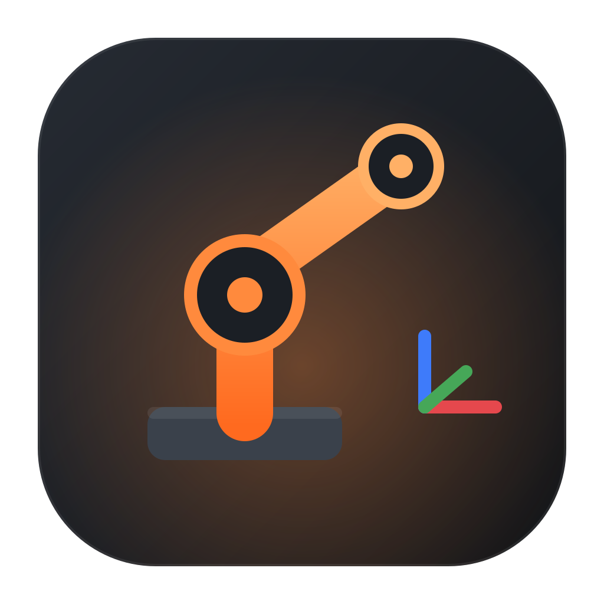
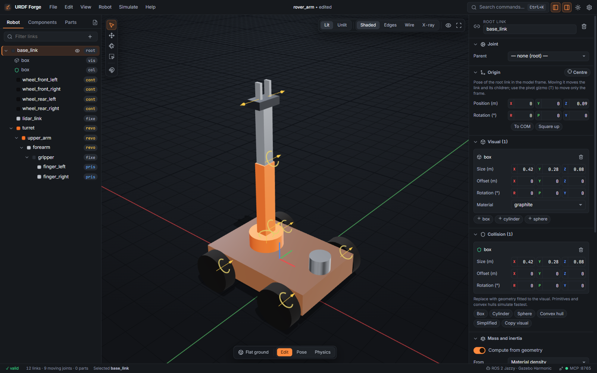
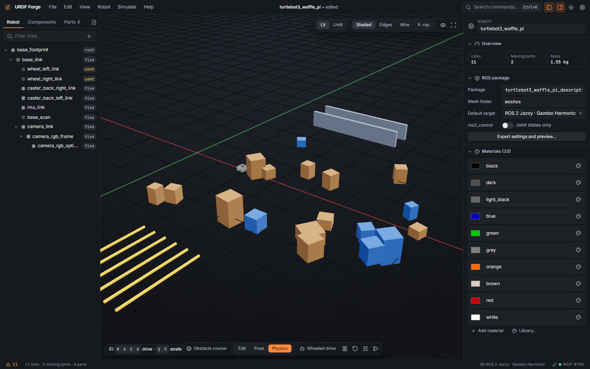
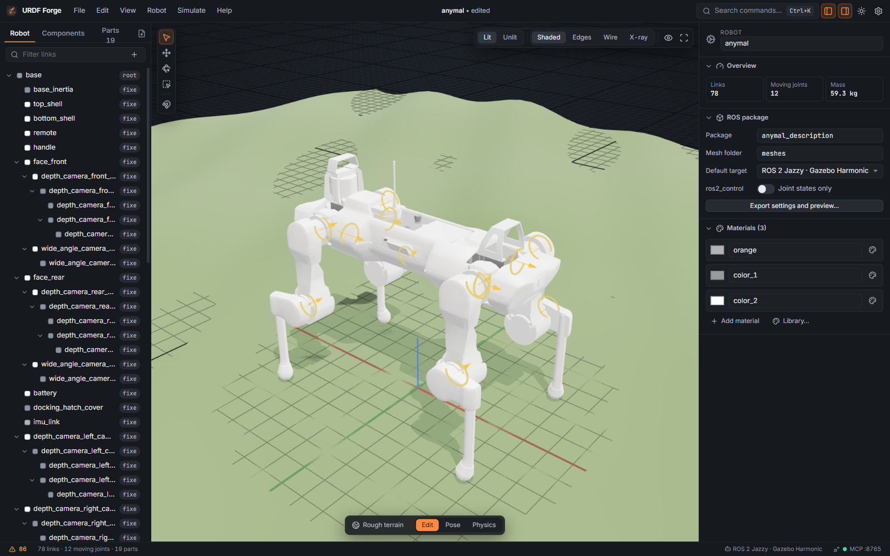
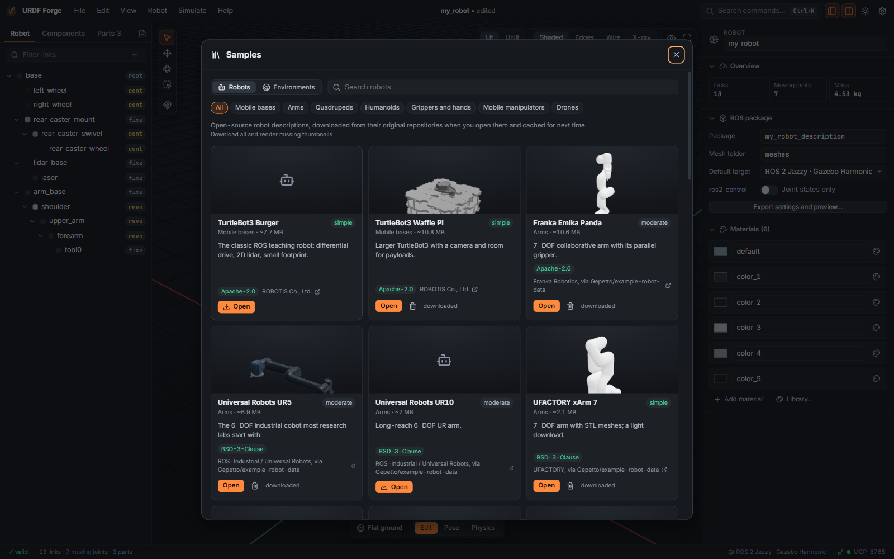

<p align="center">
  
</p>

<h1 align="center">URDF Forge</h1>

<p align="center">
  <strong>Turn CAD into ROS 2 robots.</strong><br>
  Break STEP and STL models into links, set joints and origins, test them in a physics
  preview, and export a ROS 2 package that runs in Gazebo.<br>
  Native desktop app for Windows, macOS and Linux, plus Android tablets.
</p>

<p align="center">
  <a href="https://github.com/OlumideOsuntuyi/urdf-forge/actions/workflows/ci.yml"></a>
  <a href="https://github.com/OlumideOsuntuyi/urdf-forge/releases"></a>
  <a href="LICENSE"></a>
  
  
  <a href="docs/mcp.md"></a>
</p>

<p align="center">
  <a href="HOWTOUSE.md">How to use</a> ·
  <a href="docs/tutorials/README.md">Tutorials</a> ·
  <a href="docs/user-guide.md">User guide</a> ·
  <a href="#install">Install</a> ·
  <a href="#build-from-source">Build</a> ·
  <a href="CONTRIBUTING.md">Contribute</a>
</p>

<p align="center">
  
</p>

---

URDF Forge is an open-source editor for robot descriptions. It reads your CAD output (or lets
you build a robot from a library of parametric parts), and gives you a 3D workspace to arrange
the kinematic tree, place joint origins and axes, and set mass, collisions, materials and
sensors. You can drive, walk or pose the robot in a physics preview, then export a complete
`ament_cmake` package that builds with `colcon` and spawns in the Gazebo release that matches
your ROS 2 distribution.

Everything runs locally. Your CAD never leaves your machine.

## Highlights

<table>
  <tr>
    <td width="50%"></td>
    <td width="50%"></td>
  </tr>
  <tr>
    <td><b>Physics you can drive.</b> Wheeled robots get keyboard teleop, legged robots trot,
      arms cycle through waypoints. Eight built-in test scenes plus downloadable Gazebo worlds.</td>
    <td><b>About 30 sample robots, one click away.</b> Arms, quadrupeds, humanoids, hands and
      mobile bases, downloaded from their original repositories (not bundled) and cached.</td>
  </tr>
  <tr>
    <td></td>
    <td></td>
  </tr>
  <tr>
    <td><b>Model without CAD.</b> 54 parametric components: shapes, extrusions, servos,
      steppers, wheels, lidars, cameras, boards and whole assemblies with joints already set.</td>
    <td><b>Real materials.</b> Physically based presets, 2000+ CC0 textures and HDRI
      reflections from ambientCG, exported to Gazebo as PBR materials.</td>
  </tr>
  <tr>
    <td></td>
    <td></td>
  </tr>
  <tr>
    <td><b>A gallery that draws itself.</b> Thumbnails are rendered on your machine the first
      time a robot is opened.</td>
    <td><b>One package, every distribution.</b> Humble, Jazzy, Kilted, Lyrical and Rolling,
      with launch files, ros2_control, bridges and a world.</td>
  </tr>
</table>

<p align="center">
  <br>
  <sub>Forge Light theme. Six themes in total, plus compact, comfortable and touch densities.</sub>
</p>

## Features

**Import and break down**

- STEP / STP, IGES and BREP through OpenCascade (WebAssembly). Units are read from the file
  and converted to metres; assembly names and colours are kept.
- STL (binary and ASCII), OBJ and COLLADA (DAE), with unit detection you can override.
- Files with many bodies are split into parts: one link per body, one rigid link, or parts
  only. Skip fasteners and other tiny parts in one click.
- Open existing URDF files with their meshes and keep editing them.

**Build the robot**

- Drag-and-drop hierarchy, with world poses preserved when you reparent.
- Fixed, revolute, continuous, prismatic, planar and floating joints; axis presets and flip;
  limits, effort, velocity, damping, friction, mimic joints and safety controllers.
- Move a link, only its origin (pivot), or only its mesh, in world or local space with
  snapping. Mate faces with two clicks. Number fields take maths and units (`25mm`, `90deg`,
  `pi/2`).
- Exact mass and inertia from closed meshes, by density or total mass.
- Collision geometry: fitted box, cylinder or sphere, convex hull, simplified mesh, or a copy
  of the visual.
- Sensors: IMU, camera, depth camera, lidar, contact and force-torque.
- A component library of 54 parametric parts and assemblies.

**See it**

- Lit (PBR) or unlit shading; shaded, edges, wireframe and x-ray modes.
- Studio or neutral reflections, or any HDRI from ambientCG, with optional HDRI background.
- An infinite world grid with adaptive or fixed spacing (1 mm to 1 m).
- Overlays for the world origin, link frames, joint axes, centres of mass, inertia boxes,
  collision geometry and link labels.

**Test it**

- Pose mode: joint sliders and kinematic playback.
- Physics mode (Rapier): gravity, contacts, motors tuned from each joint's effort, velocity-driven wheels and
  position-driven servos.
- Behaviours: wheeled drive (differential, skid-steer, steered, omni and mecanum) with
  keyboard or on-screen teleop, trot and step gaits for legged robots, and waypoint cycles for
  arms and grippers.
- Environments: flat ground, ramps, stairs, an obstacle course, rough terrain, a maze, a
  warehouse aisle and a table top, plus Gazebo Fuel and AWS RoboMaker worlds you can download.

**Export**

- ROS 2 Humble (Gazebo Fortress, or legacy Classic), Jazzy (Harmonic), Kilted (Ionic),
  Lyrical (Jetty) and Rolling (Jetty).
- A URDF per target, one xacro that switches with `sim:=<target>`, an SDF model, launch files
  for RViz and Gazebo, `ros2_control` controllers, `ros_gz_bridge` topics, a world with your
  chosen environment and the sensor systems loaded, `package.xml` and `CMakeLists.txt`.
- Validation catches broken trees, duplicate names, impossible inertia and bad limits before
  ROS does.

**Extend and automate**

- [Plugins](docs/plugins.md): JavaScript modules that add commands, importers, exporters and
  MCP tools.
- [MCP server](docs/mcp.md), on by default and local only: let an AI assistant inspect and
  edit the open robot, open samples, insert components and take screenshots.
- A command palette (<kbd>Ctrl</kbd>/<kbd>⌘</kbd> <kbd>K</kbd>) with every action, and a
  keyboard shortcut for most of them.

## Install

Download the installer for your platform from the
[releases page](https://github.com/OlumideOsuntuyi/urdf-forge/releases):

| Platform                            | Package                       |
| ----------------------------------- | ----------------------------- |
| Windows 10/11                       | `.msi` or `-setup.exe`        |
| macOS 11+ (Apple silicon and Intel) | `.dmg`                        |
| Linux                               | `.AppImage`, `.deb` or `.rpm` |
| Android 7+ (tablets recommended)    | `.apk`                        |

## Quick start

1. **File → Import** (<kbd>Ctrl</kbd>+<kbd>I</kbd>), or drop a STEP or STL file on the window.
   No CAD to hand? Try **File → Browse sample robots** or the **Components** tab.
2. Choose **One link per body** and press **Import**.
3. In the **Robot** tree, drag each link onto its parent.
4. Select a link, set its joint type and axis in the inspector, and move its origin to the
   hinge: <kbd>W</kbd> for the move gizmo, then <kbd>T</kbd> until it says **Origin**.
5. Press <kbd>F7</kbd> for physics. Wheeled robots drive with <kbd>W</kbd> <kbd>A</kbd>
   <kbd>S</kbd> <kbd>D</kbd>.
6. **File → Export ROS 2 package** (<kbd>Ctrl</kbd>+<kbd>E</kbd>) into `~/ros2_ws/src`, then:

```bash
cd ~/ros2_ws && colcon build --packages-select my_robot_description
source install/setup.bash
ros2 launch my_robot_description gazebo_jazzy-harmonic.launch.py
```

**Where to go next:** [HOWTOUSE.md](HOWTOUSE.md) answers "how do I…?" questions, and the
[tutorials](docs/tutorials/README.md) walk through complete projects step by step.

## Documentation

| Document                              | What's in it                                          |
| ------------------------------------- | ----------------------------------------------------- |
| [HOWTOUSE.md](HOWTOUSE.md)            | Task-by-task answers and the keyboard shortcut sheet  |
| [Tutorials](docs/tutorials/README.md) | Seven step-by-step projects, from first import to MCP |
| [User guide](docs/user-guide.md)      | Reference for every panel, mode and option            |
| [Plugins](docs/plugins.md)            | Writing and installing plugins                        |
| [MCP](docs/mcp.md)                    | Connecting AI assistants and the tool reference       |
| [Building](docs/building.md)          | Building the desktop apps and the Android APK         |
| [Architecture](docs/architecture.md)  | How the code is organised, for contributors           |

## Build from source

You need Node.js 20+, Rust (stable) and the
[Tauri prerequisites](https://v2.tauri.app/start/prerequisites/) for your OS.

```bash
npm ci
npm run app:dev       # run the desktop app with hot reload
npm run app:build     # build installers for this OS
npm test              # unit tests
npm run lint          # ESLint and Prettier
```

Android builds need the Android SDK, NDK and a JDK; see [docs/building.md](docs/building.md).

## Project layout

```
src/core          framework-free model, geometry, environments and ROS export (unit tested)
src/viewport      three.js scene: grid, materials, gizmos, thumbnails
src/sim           Rapier physics, pose playback and behaviours (drive, gait, arm)
src/samples       downloadable robot and environment catalogue
src/materials     ambientCG materials and HDRIs
src/ui            React interface
src/commands      command registry used by menus, shortcuts, palette, plugins and MCP
src/plugins       plugin host and API
src/mcp           MCP tools (the Rust side owns the HTTP transport)
src-tauri         Rust shell: windows, dialogs, file access, HTTP, MCP server
docs              user and developer documentation
plugins/examples  sample plugins
```

## Contributing

Bug reports, feature ideas and pull requests are welcome. Please read
[CONTRIBUTING.md](CONTRIBUTING.md) and the [Code of Conduct](CODE_OF_CONDUCT.md). Report
security issues privately as described in [SECURITY.md](SECURITY.md).

## Acknowledgements

URDF Forge stands on the work of many open-source projects:

- [Tauri](https://tauri.app), [React](https://react.dev), [three.js](https://threejs.org),
  [Zustand](https://zustand.docs.pmnd.rs) and [Vite](https://vite.dev).
- [Open CASCADE Technology](https://dev.opencascade.org) via
  [occt-import-js](https://github.com/kovacsv/occt-import-js) for STEP, IGES and BREP.
- [Rapier](https://rapier.rs) for physics.
- [ambientCG](https://ambientcg.com) for CC0 materials and HDRIs.
- Sample robots from [example-robot-data](https://github.com/Gepetto/example-robot-data),
  ROBOTIS, Franka Robotics, Universal Robots, UFACTORY, Kinova, ANYbotics, PAL Robotics,
  Hello Robot, Wonik Robotics, IIT, NASA JSC and other authors credited on each card.
- Sample worlds from [Gazebo Fuel](https://app.gazebosim.org) and
  [AWS RoboMaker](https://github.com/aws-robotics).
- [Inter](https://rsms.me/inter/), [JetBrains Mono](https://www.jetbrains.com/lp/mono/) and
  [Lucide](https://lucide.dev) icons.

Samples are downloaded from their authors' repositories and keep their own licences; check
each card before redistributing a robot or world.

## License

URDF Forge is licensed under the [Apache License 2.0](LICENSE). Third-party components and
their licences are listed in [NOTICE](NOTICE).
