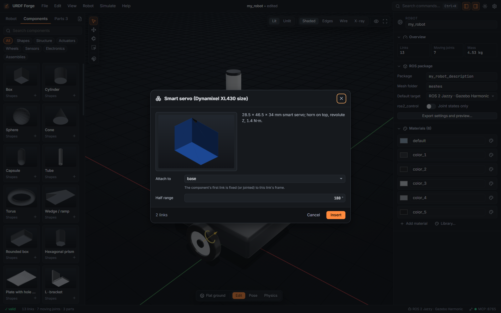

# Tutorial 2: A rover from components

No CAD needed. You will build a small differential-drive rover with a lidar, a camera on a
pan-tilt head and an onboard computer, entirely from the parametric component library, then
drive it around.

**You will learn to:** insert components, set their parameters, attach them to links, and
adjust their placement.

**Time:** about 15 minutes.

## 1. Start a new project

**File → New project** (<kbd>Mod</kbd>+<kbd>N</kbd>). You get an empty robot; the first
component you insert becomes its root link.

## 2. Add a drive base

1. Open the **Components** tab in the left panel.
2. In **Assemblies**, click **Differential-drive base**.
3. The dialog shows a live preview and the parameters: chassis length, width and height, wheel
   radius and width, and the preview speed. Set the wheel radius to `45mm` and leave the rest.
4. Press **Insert**. In an empty project there is nothing to attach to, so the base becomes the
   root; later components get an **Attach to** field.

You now have a chassis, two driven wheels on continuous joints with wheel drives, and a caster.
Mass, inertia and collision shapes are already set.

> Prefer four wheels? Use **4-wheel skid-steer base** instead. For holonomic driving, build a
> base from **Mecanum wheel** or **Omni wheel** components.

## 3. Add sensors and electronics

Insert these one at a time. Select the chassis link first and **Attach to** defaults to it:

| Category    | Component                           | Suggested settings                 |
| ----------- | ----------------------------------- | ---------------------------------- |
| Sensors     | 2D lidar (RPLidar A1 style)         | defaults                           |
| Electronics | Raspberry Pi 4 size board           | defaults                           |
| Electronics | LiPo battery                        | defaults                           |
| Assemblies  | Pan-tilt unit                       | defaults                           |
| Sensors     | Depth camera (RealSense D435 style) | attach to the pan-tilt's tilt link |

Each sensor comes with its Gazebo sensor definition, so the exported package publishes
`/scan` and the camera topics without extra work.

## 4. Place the parts

Components arrive at their parent's origin. Move each one where it belongs:

1. Select the link (for example the lidar).
2. Press <kbd>W</kbd>; make sure the gizmo target is **Link** (press <kbd>T</kbd> to cycle).
3. Drag it on top of the deck, or type the position in **Origin** in the inspector, for
   example `x = 0.05`, `z = 0.08`.
4. Turn on snapping (<kbd>S</kbd>) and the fixed grid (palette: **Grid: fixed 1 cm**) for tidy
   placement.

Use **Mate faces** (<kbd>F</kbd>) to sit the battery flat on the deck: click the battery's
bottom face, then the deck's top face.

## 5. Check it

1. **Robot** in the inspector (click empty space to deselect) shows total mass and the number
   of moving joints.
2. The **Problems** tab should be empty or show only warnings.
3. Press <kbd>F6</kbd> and drag the pan and tilt sliders.

## 6. Drive it

1. Press <kbd>F7</kbd> for **Physics**. The behaviour button on the mode bar should read
   **Wheeled drive**; if not, pick it.
2. Drive with <kbd>W</kbd> <kbd>A</kbd> <kbd>S</kbd> <kbd>D</kbd> or the arrow keys;
   <kbd>Space</kbd> stops. On a tablet, use the on-screen pad.
3. Pick **Obstacle course** from the globe button and try to get through the narrow passage.

If the rover tips or slides, check that both wheels touch the ground (show collisions with
<kbd>C</kbd>) and that the battery and computer are low and central.

## 7. Save

**File → Save as** (<kbd>Mod</kbd>+<kbd>Shift</kbd>+<kbd>S</kbd>), for example
`my_rover.forge`.

## Next

- Test it properly: [Tutorial 3, Drive, walk and test in physics](03-drive-walk-and-test.md).
- Export it: [Tutorial 5](05-export-and-run-in-gazebo.md).
- The full list of components is in the [user guide](../user-guide.md#model-from-components).
