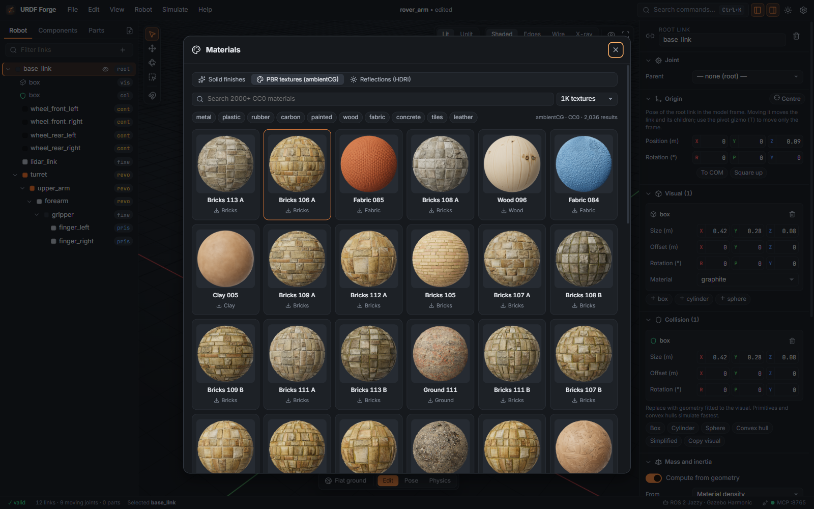
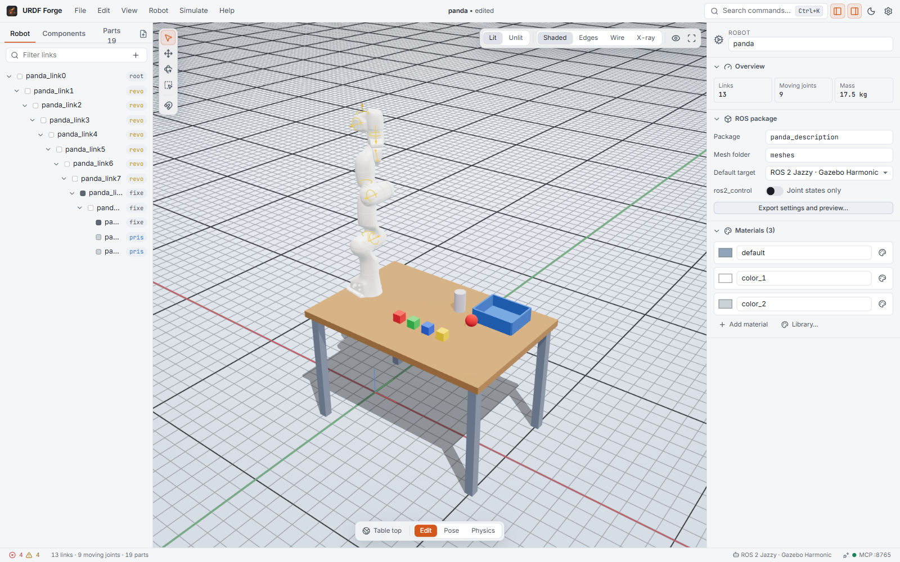

# Tutorial 4: Materials, lighting and looks

Make your robot look like the real thing in the editor and in Gazebo: physically based
presets, downloadable PBR textures, HDRI reflections, and the viewport settings that make
screenshots and reviews easier.

**You will learn to:** use material presets, apply ambientCG textures, change reflections,
switch between lit and unlit shading, and set up the grid and theme.

**Time:** about 15 minutes. Texture and HDRI downloads need an internet connection.

## 1. How materials work

A material belongs to the robot and can be shared by many links. Each has a colour (RGBA),
metalness, roughness and optionally clear coat and texture maps. The inspector shows the
robot's materials when nothing is selected, and each link's material in its **Material**
section.

Exports carry all of it:

- the URDF gets a `<material>` with the colour (and a `<texture>` when there is one);
- Gazebo gets a PBR `<material>` with metalness, roughness and the texture maps;
- RViz shows the colour.

## 2. Presets

1. Load a robot (your own, or **File → Load sample robot**).
2. Select a link and click the palette icon next to its material, or press <kbd>M</kbd> to open
   the **Material library**.
3. On **Presets**, pick for example **Anodised aluminium, blue** for the chassis,
   **Rubber, black** for the tyres and **Carbon fibre (solid)** for the arm. There are 29
   presets: metals, plastics, 3D-printing filaments, rubber, paint, PCB, glass and more.

Presets set physically sensible metalness and roughness, so they look right under any lighting.
Fine-tune a material in the inspector: colour, metalness, roughness and clear coat.

## 3. PBR textures from ambientCG

[ambientCG](https://ambientcg.com) publishes over 2000 materials under CC0 (public domain), so
you can use them in any project and ship them in your ROS package.

1. Open the library on **PBR textures (ambientCG)**.
2. Search, for example `metal plate`, `plastic` or `wood`.
3. Choose **1K** (lighter) or **2K** (sharper) textures.
4. Click a material. It downloads, appears in your robot's materials and is applied to the
   selected link.

Texture maps (colour, normal, roughness, metalness, ambient occlusion) are box-projected onto
the mesh, so they work on CAD meshes that have no UVs. On export, textured meshes are written
as OBJ files with UVs and the images go into `materials/textures/`, so Gazebo shows the same
surface. Saved projects include the textures, so they open offline.

## 4. Reflections and lighting

Reflective materials need something to reflect.

- The viewport's lighting popover (top right) and **Material library → Reflections (HDRI)**
  offer **Studio** (soft boxes, good for metals), **Neutral** (even and dim, good for judging
  colour) and any ambientCG HDRI (outdoor, workshop, warehouse…).
- Tick **HDRI background** to show the HDRI behind the robot instead of the plain background.
- The reflection strength slider balances reflections against the lights.
- <kbd>L</kbd> toggles the studio key and fill lights. Shadows are in the same popover.

## 5. Lit and unlit

<kbd>U</kbd> switches between:

- **Lit**: physically based shading with reflections, the closest to the real robot.
- **Unlit**: flat colours with no lighting. Every part reads clearly from every angle, which is
  handy when you are building the tree, checking which part is which, or working on a slow
  machine.

The shading mode (<kbd>Z</kbd>: shaded, shaded with edges, wireframe, x-ray) works in both.
X-ray is the quickest way to see joint frames buried inside a housing.

## 6. The grid

<kbd>G</kbd> toggles the infinite world grid. In the lighting/grid popover, or the palette:

- **Adaptive**: the spacing follows the zoom level, from millimetres to tens of metres.
- **Fixed**: 1 mm, 1 cm, 5 cm, 10 cm, 50 cm or 1 m, for measuring and for placing parts with
  snapping.

The grid sits at z = 0. Robots are placed standing on it: when the root frame is mid-body (as
on many legged robots), the robot is lifted so its lowest point touches the floor.

## 7. Themes and density

- **Settings → Appearance** (<kbd>Mod</kbd>+<kbd>,</kbd>): Forge Dark, Forge Light, Midnight,
  Nord, Solarized Light, High Contrast, or follow the system; and compact, comfortable or touch
  density.
- The sun/moon button in the title bar switches between light and dark; the palette has
  **Theme: …** for each theme.

## Next

[Tutorial 5, Export and run in Gazebo](05-export-and-run-in-gazebo.md): see the same materials
in the simulator.
