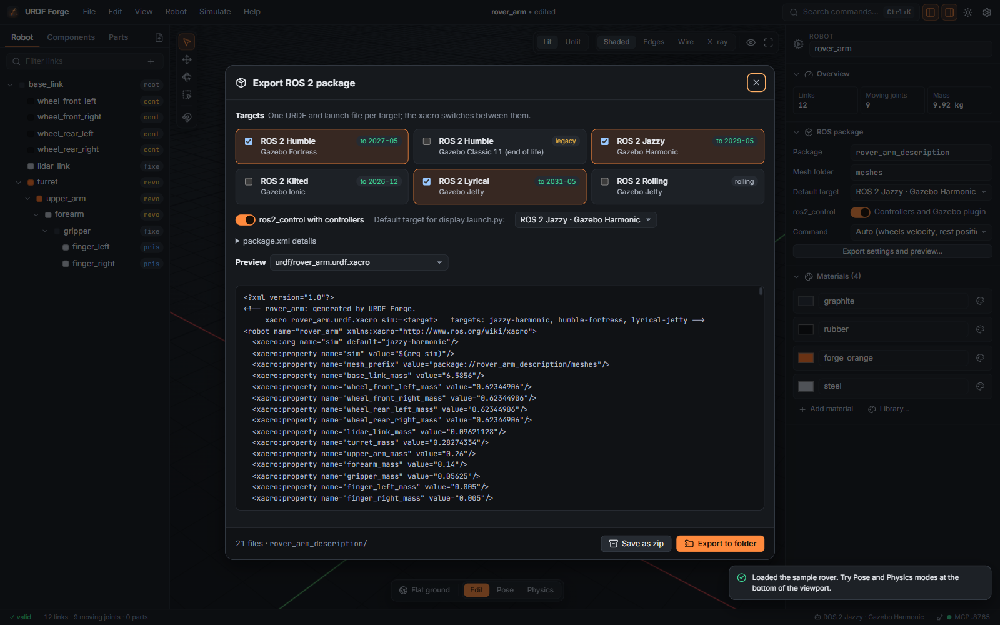

# Tutorial 5: Export and run in Gazebo

Turn your robot into a ROS 2 package, build it with colcon, view it in RViz, and spawn it in
Gazebo in the same environment you tested in, with controllers you can command from the
terminal.



**You will learn to:** validate, choose targets, export, build, launch, and drive joints
through ros2_control.

**Time:** about 20 minutes, plus build time.

## What you need

- A robot in URDF Forge, for example the rover from [Tutorial 2](02-rover-from-components.md).
- ROS 2 with Gazebo on Linux (natively, in a VM, in WSL2 or in a container). Install the extras
  the package uses:

```bash
# Jazzy + Gazebo Harmonic shown; replace "jazzy" with your distribution.
sudo apt install ros-jazzy-ros-gz ros-jazzy-gz-ros2-control \
  ros-jazzy-ros2-controllers ros-jazzy-xacro ros-jazzy-joint-state-publisher-gui
```

## 1. Validate

Open the **Problems** tab (<kbd>Mod</kbd>+<kbd>J</kbd>). Errors (red) would break ROS tools:
duplicate names, a link with two parents, zero mass on a moving link, impossible inertia,
lower limit above upper. Fix all of them. Warnings (amber) are worth reading: open meshes,
missing collisions, very light links.

## 2. Choose targets and options

**File → Export ROS 2 package** (<kbd>Mod</kbd>+<kbd>E</kbd>).

| Target            | ROS 2   | Simulator                  |
| ----------------- | ------- | -------------------------- |
| `humble-fortress` | Humble  | Gazebo Fortress            |
| `humble-classic`  | Humble  | Gazebo Classic 11 (legacy) |
| `jazzy-harmonic`  | Jazzy   | Gazebo Harmonic            |
| `kilted-ionic`    | Kilted  | Gazebo Ionic               |
| `lyrical-jetty`   | Lyrical | Gazebo Jetty               |
| `rolling-jetty`   | Rolling | Gazebo Jetty               |

Tick every target you need; one package serves them all. Then:

- The package name defaults to `<robot>_description`; change it in the inspector under
  **ROS package** (click empty space to see the robot's properties).
- **ros2_control**: turn on to get controllers (joint state broadcaster, plus position,
  velocity or effort groups depending on each joint's drive).
- The file list on the right previews every generated file. Click one to read it.

## 3. Export

Choose **Export to folder** and pick `~/ros2_ws/src` (or a shared folder your ROS machine can
see), or **Save as zip** and unzip it there. You get:

```
my_rover_description/
├── package.xml, CMakeLists.txt, README.md
├── urdf/
│   ├── my_rover.urdf.xacro          # source of truth: xacro ... sim:=<target>
│   ├── my_rover.urdf                 # default target, pre-expanded
│   └── my_rover.<target>.urdf        # one per target
├── sdf/my_rover/model.sdf            # standalone SDF model
├── meshes/                           # STL meshes (OBJ with UVs for textured parts)
├── materials/textures/               # PBR texture maps, if any
├── launch/
│   ├── display.launch.py             # RViz + joint sliders
│   └── gazebo_<target>.launch.py     # one per target
├── config/
│   ├── controllers.yaml              # ros2_control
│   └── gz_bridge_<target>.yaml       # ROS <-> Gazebo topics (clock, sensors, joint states)
├── worlds/                           # empty world, plus your test environment
├── rviz/view.rviz
└── my_rover.forge.json               # a copy of the project
```

## 4. Build

```bash
cd ~/ros2_ws
rosdep install --from-paths src --ignore-src -y
colcon build --packages-select my_rover_description
source install/setup.bash
```

## 5. Look at it in RViz

```bash
ros2 launch my_rover_description display.launch.py
```

Move the sliders in the joint state publisher window. Frames, axes and limits should match
what you saw in URDF Forge.

## 6. Spawn it in Gazebo

```bash
ros2 launch my_rover_description gazebo_jazzy-harmonic.launch.py
```

The robot spawns in the environment you picked in the app (or an empty world). Override with
launch arguments:

```bash
ros2 launch my_rover_description gazebo_jazzy-harmonic.launch.py \
  world:=/path/to/other_world.sdf x:=1.0 y:=0.5 z:=0.2
```

Sensors publish through the bridge. With the lidar from Tutorial 2:

```bash
ros2 topic list
ros2 topic echo /scan --once
```

## 7. Move joints with ros2_control

With **ros2_control** on, the launch file loads the controllers after the robot spawns. Check
them:

```bash
ros2 control list_controllers
```

Wheels and continuous joints are in `velocity_controller`, servos in `position_controller`. The
order of values is the order of joints in `config/controllers.yaml`.

```bash
# Spin both wheels at 3 rad/s
ros2 topic pub --once /velocity_controller/commands std_msgs/msg/Float64MultiArray "{data: [3.0, 3.0]}"

# Move the pan-tilt to 0.5 rad and -0.3 rad
ros2 topic pub --once /position_controller/commands std_msgs/msg/Float64MultiArray "{data: [0.5, -0.3]}"
```

For proper driving, set **Robot → Export → Base** to **diff_drive_controller** before
exporting. The wheels, their separation and radius are taken from the model, and you drive with
`/diff_drive_controller/cmd_vel` (`geometry_msgs/TwistStamped` from Jazzy on):

```bash
ros2 run teleop_twist_keyboard teleop_twist_keyboard --ros-args \
  -r cmd_vel:=/diff_drive_controller/cmd_vel -p stamped:=true
```

## Troubleshooting

| Symptom                               | Fix                                                                                                |
| ------------------------------------- | -------------------------------------------------------------------------------------------------- |
| `package 'xyz' not found`             | `source install/setup.bash` in this terminal                                                       |
| Gazebo shows the robot without meshes | Build again after exporting; the launch file adds the install share path to Gazebo's resource path |
| The robot falls through the floor     | Collision geometry missing on the lowest links                                                     |
| Controllers fail to load              | Install `gz_ros2_control` (or `gazebo_ros2_control` for Classic) and `ros2_controllers`            |
| Textures missing in Gazebo            | Use a Gazebo target (not Classic); Classic does not read PBR maps                                  |

## Next

Let an assistant do the repetitive parts: [Tutorial 6, Automate with MCP](06-automate-with-mcp.md).
